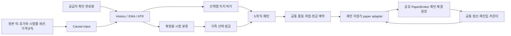

# Bin 독립 Core 구조

2026-11-11 사용자 요청 범위에 맞춰 `Stock.Core/Strategies/Bins`를 추가했다. 기존 Inje/UI와 실제 거래기록을 보존한다. Bin의 세 가족·다섯 패턴을 Inje registry에 혼합하거나 구전략 분기로 재사용하지 않는다. `bins-strategy-v1` 전용 strict JSON과 설정 snapshot/hash를 사용한다.

`BinsStrategyEngine`의 계좌 lock이 시장 이벤트·주문 예약·실행 보고·확인 체결을 직렬화한다. `OnExecutionReport`도 같은 lock을 사용한다. 보유/미체결/미확인 상태에는 새 가족/포지션으로 바꾸지 않으며, 포지션 청산 설정은 진입 사본으로 고정한다. 신규 진입 OFF는 즉시 적용하고 보유 보호는 유지한다.

재생과 모의운용은 같은 엔진을 호출한다. 완료봉의 KnownAt과 원본 도착 순서를 유지하며, 중복·역순·미래·진행봉·빈 봉으로 판단을 만들지 않는다. 증분 EMA/ATR은 이력 버퍼가 줄어도 재시작하지 않는다. 박스·미세 고점·지지 하단은 사용하는 에피소드의 앵커로 잠근다.

기존 `PaperBroker`에 `ApplySimulationFill` 내부 메서드를 추가해 확인된 가상 체결만 현금·수량·평균가·미배분 비용에 반영한다. 기존 수동·Inje 매칭 경로는 변경하지 않는다. 실제 주문 어댑터를 Bin에 연결하지 않으며 Live 어댑터는 거절한다. 가격 단위/비용/세션을 추정해서 채우지 않는다.

거래일 봉은 공급자 확인 입력이며 경과시간 Day와 별개다. KRW/USD 계좌와 위험을 독립 처리한다. 원본 틱 없는 연구는 UnsupportedPrecision이다. Bin 저장 복원·기존 UI 선택기·실피드 연결·배포는 이번 작업 범위 밖이다.

전체 수식·22개 결정·DecisionLog·파라미터/JSON·검증과 한계는 [통합 가이드](../strategy/Bins_Strategy_구현_검증_가이드_2026-11-11.md)에 있다.

## Avalonia 연결 — 2026-11-11 후속

`StrategyProfile`은 네 Inje 정의와 Bin 설정을 함께 저장하고 `SelectedSystem` 하나만 실행 envelope로 변환한다. `BinsEditorModel`은 typed JSON draft를 스칼라·기간/봉 단위·우선순위·거래소·비용표 필드로 연결한다. `BinsResearchBridge`가 원본 이벤트와 당시 자료를 replay/screen으로 전달한다. MarketEvent의 BinSession/BinMetadata/BinCompletedBars/BinProfileTrades는 선택적 공급자 자료이며 없으면 추정하지 않는다. 스크리닝의 `evaluationOnly` 모드는 동일한 패턴·위험 계산 후 ScreenMatched를 남기고 SubmitBuy를 호출하지 않는다. 첨부 완료봉도 최종 원본 이벤트 시점 이후라면 스크리닝에서 제외한다. Bin 실시간 가상 주문/원장 복원은 아직 연결하지 않았으며 host가 시작을 거절한다.
