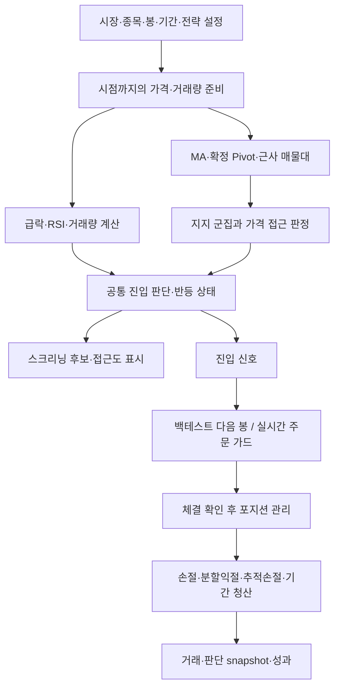

# STOCK 과매도·낙주 반등 전략 — 계산 로직 상세 설명서

작성 기준: 2026-11-07 로컬 소스 및 실행 앱. 목적: 이 파일 하나를 ChatGPT에 첨부해 **현재 구현을 정확히 이해하고 전략 설계·검증 방법을 논의**하기.

이 문서는 새 전략 제안이나 수익성 보증이 아니라 **실제 코드의 동작 설명**이다. 원래 요구한 아이디어, 현재 구현, 앞으로 결정할 사항을 구분한다. 숫자는 모두 변경 가능한 설정값이며, 아래 기본값을 사용자가 지금 쓰는 값으로 오해하면 안 된다. 앱·전략·주문 로직은 이 문서 작성 과정에서 수정하지 않았다.

## 먼저 알아둘 세 가지

1. **전략 알고리즘은 과매도·낙주 반등 한 계열**이고, 등록된 여러 전략 이름은 주로 서로 다른 파라미터 프리셋이다. `전략 진단`과 `백테스트 검증 1/2/3`은 별도 수익 모델이 아니라 동일 엔진의 검사 설정이다.
2. **스크리닝 후보 ≠ 실제 매수 신호 ≠ 주문 접수 ≠ 체결.** 특히 근접 후보와 자료 미확인 연구 후보가 목록에 나타나도, 곧바로 매수된 것으로 취급하지 않는다.
3. 문서 작성 때 앱에 선택돼 있던 설정은 **`백테스트 검증 1 · 1일 보유`**다. 급락·지지 조건을 매우 완화하고 익절·비상손절 등을 끈 검사 설정이므로 원래 기본 전략과 성격이 다르다. 18장에 61개 값을 나란히 비교하고, 부록에는 실제 내보낸 JSON을 넣었다. 내보내기는 당시 편집값의 snapshot이며, 별도로 `설정 저장`을 누른 사실까지 증명하는 것은 아니다.

## 목차

1. 핵심 아이디어와 전체 흐름
2. 가격·시간·봉 단위
3. 대상 종목과 자료 신뢰도
4. 급락 계산
5. RSI·거래량 필터
6. 이동평균 지지
7. 확정 과거 고점
8. 근사 매물대
9. 지지 군집
10. 진입 후보와 반등 상태
11. 매수 신호와 모형 체결
12. 분할매수
13. 청산 우선순위·익절·추적 손절
14. 보유기간·재진입
15. 일반/실시간 스크리닝과 접근도
16. 실시간 가상/실제 주문 연결
17. 손익·성과 지표
18. 전체 파라미터 비교표
19. 숫자로 따라가는 예제
20. 현재 구현의 한계와 논의할 사항
21. ChatGPT에 함께 보낼 질문
22. 근거 코드와 부록 JSON

---

## 1. 핵심 아이디어와 전체 흐름

가격이 많이 떨어졌다는 사실만으로 사는 대신, 급락한 가격이 여러 장기 지지 근거가 모인 구간에 들어왔는지를 본다. 선택적으로 RSI·거래량·반등을 확인한 뒤 분할 진입하고, 최초 지지 구간이 깨지면 청산하며 반등하면 부분 익절과 추적 손절을 사용한다.



이 전략은 매수 후 보유·매도하는 매수 포지션(long only) 전략이다. 급락의 ‘단기’라는 표현은 단기 낙폭을 뜻하며 공매도/숏 포지션을 뜻하지 않는다.

매수 전 진입 후보 상태와, 체결 후 포지션 상태는 별개다. 스크리닝은 전자를 평가하며 실제 계좌를 보유한 것으로 상태를 진행시키지 않는다. 백테스트와 실행 서비스가 체결 및 보유 상태를 담당한다.

## 2. 가격·시간·봉 단위

### 2.1 표기

- `O_t, H_t, L_t, C_t, V_t`: t번째 봉의 시가·고가·저가·종가·거래량.
- `T_t`: 그 봉의 거래대금. 없으면 null이며, 0과 다르다.
- `n`: 선택한 **봉 개수**. `CrashLookbackDays`처럼 이름에 Days가 남아 있어도 지표 기간은 선택 봉 수다.
- `%` 파라미터는 퍼센트 포인트다. `-20`은 `-20.00%`, `0.015`는 `0.015%`이며 수식에서 100으로 나눈다.
- `floor(x)`: 내림. 주식 모형 수량은 정수다.

내부 계산은 decimal 원정밀도를 유지한다. 화면의 가격 정수 내림/퍼센트 소수 둘째 자리 표시는 계산값을 반올림해 저장한다는 뜻이 아니다. 예를 들어 수수료 0.015%가 화면에는 0.02%로 보일 수 있어도, 편집하지 않았다면 원래 저장값 0.015%를 유지한다. 검증 프리셋의 0.001%도 화면 두 자리로는 0.00%처럼 보일 수 있으므로 JSON 값을 함께 봐야 한다.

### 2.2 현재 선택 범위

| 환경 | 전략 분석 기준 |
|---|---|
| 오프라인 | 일봉 |
| 온라인 국내 | 일봉 또는 지정봉: 분 1~59, 시간 1~12 |
| 해외 연구 | 현재 일반 스크리닝/백테스트는 일봉 중심. 국내 지정봉 실행 경로와 동일한 지원 범위라고 보면 안 됨 |
| 원본 틱 | 내부 체결 수신·봉 생성에 사용. 표시용 틱 선택기는 숨긴 상태 |

UI가 12시간까지 숫자를 제공해도 국내 정규장 6시간 30분보다 긴 봉은 완성할 수 없어 사용 가능한 봉이 생기지 않는다. 값 선택 가능과 유효 자료 존재는 다르다.

5분봉·중기 낙폭 20이면 최근 20개 5분봉을 뜻한다. 장중 휴식·장 마감·휴장에 따라 실제 경과시간이 단순 100분보다 길 수 있다. RSI14, MA240 등도 같은 봉 기준이다. 반면 `MaxHoldingDays`, `CandidateLifetimeDays`, `ReentryCooldownDays`는 시장 거래일/세션 인덱스 기준이다.

### 2.3 봉 생성

분·시간봉은 세션 시가 기준으로 정렬한다. 기본 국내 세션은 09:00~15:30이다.

```text
Open   = 첫 원본 봉/체결의 가격
High   = 구간 내 최고가
Low    = 구간 내 최저가
Close  = 마지막 원본 봉/체결의 가격
Volume = 구간 거래량의 합
```

- 원본 체결이 연속으로 확인되면 실제 `합계(체결가격 × 체결량)`을 거래대금으로 쓴다.
- 키움 OHLCV 분봉 경로에서는 실제 분봉 거래대금 필드가 없어 `(O+H+L+C)/4 × V`를 **추정 거래대금**으로 사용하며 출처에 표시한다.
- 원본 분봉이 빠진 구간을 임의로 채우지 않는다. N분봉에는 필요한 원본 봉 수와 연속 시각이 맞아야 한다.
- 세션 마지막의 짧은 구간은 요청한 길이의 완성봉으로 내보내지 않는다. 예: 1시간봉은 09~15시의 6개 완성봉이며 15~15:30을 1시간봉으로 만들지 않는다.
- 미완성 봉은 실행용 확정 신호에 사용하지 않는다. 일반 일봉 스크리닝에는 **진행봉 연구 미리보기**가 포함될 수 있으며 백테스트와 구분한다.

## 3. 대상 종목과 자료 신뢰도

### 3.1 Universe

국내 기본 대상은 코스피/코스닥 일반주식이다. ETF·ETN·SPAC, 거래정지·관리종목은 확인된 자료에 따라 제외한다. UI에서는 현재 시가총액 상위 목록 또는 관심그룹을 선택하며, 현재 상위 개수는 10/25/50/100이다. 코스피+코스닥이면 각 시장 목록을 결합한다. 전체 과거 상장 종목을 매일 재구성하는 생존편향 없는 universe 엔진은 아니다.

해외 일반 스크리닝에는 S&P500/나스닥100/합집합의 **현재 구성 종목**이 있다. 과거 편입·편출을 재현하지 않는다. 금액은 USD이며 KRW 설정을 자동 환전하지 않는다.

### 3.2 거래대금 필터

현재 봉을 제외한 직전 n개 봉의 거래대금 평균을 계산한다.

```text
AverageTradingValue_t = (T_(t-n) + ... + T_(t-1)) / n
통과 = 필요한 n개 값이 모두 있고 평균 ≥ MinimumAverageTradingValue
```

기본 n=20, 최소 3,000,000,000원(30억원)이다. **1분봉에서도 값이 그대로라면 직전 20개 1분봉의 평균 거래대금 30억원**을 요구한다. 일평균 30억원과 전혀 다르다. 지정봉을 바꿀 때 거래대금·거래량 등의 경제적 의미도 바뀐다.

엄격한 진입/백테스트에서 자료가 없으면 최소값을 0으로만 낮춰도 자동 통과하지 않는다. `UsePriceOnlyBacktest=true`이면서 최소 거래대금이 0인 경우에만 이 필터의 자료 준비를 모형에서 생략할 수 있다. 단순 현재가×거래량을 실제 거래대금으로 둔갑시키지는 않는다.

### 3.3 시점별 상태와 악재

`HistoricalFacts`는 종목·날짜별 상태/거래대금/위험에 `KnownAt`을 가진다. 판단 시각 이전에 알려진 자료 중 가장 최근 것을 사용한다. 어제의 자료를 오늘 값으로 자동 채우거나 오늘의 상태를 과거 전체에 일괄 적용하지 않는다.

- 매수 가능: 일반주식, 허용 시장, 정지=false, 관리=false, 위험=false.
- 위험=true: 신규/추가 매수 금지.
- 위험=null: 미확인이다. 엄격한 실행에서는 false로 취급하지 않는다.
- 뉴스·공시를 읽어 위험을 자동 분류하는 기능은 이 전략의 계산에 들어 있지 않다.
- 일반 스크리닝 연구 모드에서는 미확인 정보를 표시하고 다른 가격 조건 계산을 계속할 수 있다. 이 결과가 주문 허가가 되지는 않는다.
- 가격자료 검증 백테스트와 공개시세 모의 경로에는 별도의 일반주식·정지 아님·위험 없음 **가정**이 있을 수 있다. 실제 확인 자료와 구분한다.

## 4. 급락: 중기 OR 단기

현재 봉을 포함한 최근 n개 봉의 최고 고가를 사용한다.

```text
RecentHigh_n(t) = max(H_(t-n+1), ..., H_t)
Drawdown_n(t)   = (C_t / RecentHigh_n(t) - 1) × 100
```

- 중기: n=20, 낙폭 ≤ -20.00%.
- 단기: n=3, 낙폭 ≤ -15.00%.
- 둘 중 하나가 통과하면 Trigger. 둘 다면 `Medium+Short`, 각각 `Medium`, `Short`로 기록한다.
- **3봉 전 종가와 비교하는 수익률이 아니다.**
- 각 경로는 해당 lookback만큼의 봉이 준비돼야 Trigger를 낸다.

예: 최근20봉 최고 고가50,000원, 종가39,000원이면 -22.00%다. 단기 최고 고가50,000원, 종가42,000원이면 -16.00%다.

Trigger가 한 번 발생했다는 사실만으로 이후 아무 때나 진입하지 않는다. 현재 진입 평가에서도 해당 시점의 Trigger와 활성 필터·지지 접근 조건이 필요하다.

## 5. 과매도 보조필터

### 5.1 RSI: Wilder 방식

```text
Delta_t = C_t - C_(t-1)
Up_t    = max(Delta_t, 0)
Down_t  = max(-Delta_t, 0)
```

첫 n개의 가격 변화로 평균 상승/하락을 초기화한다. 이후는 다음과 같다.

```text
AvgGain_t = (AvgGain_(t-1) × (n-1) + Up_t) / n
AvgLoss_t = (AvgLoss_(t-1) × (n-1) + Down_t) / n
RSI_t     = 100 - 100 / (1 + AvgGain_t / AvgLoss_t)
```

하락 평균이0이고 상승 평균도0이면 RSI50, 하락 평균0·상승 평균양수이면100이다. 첫 n개 변화에는 n+1개 종가가 필요하다. `UseRsiFilter=true`이면 RSI가 있고 `RSI ≤ MaximumRsi`여야 한다. 기본14/30이다. OFF이면 이 필터는 진입을 막지 않는다.

### 5.2 거래량 증가

```text
PreviousAverageVolume_t = mean(V_(t-n), ..., V_(t-1))
VolumeRatio_t = V_t / PreviousAverageVolume_t
```

현재 봉은 분모에서 제외한다. 기본 n=20, 비율≥2.00이다. 평균이0이거나 준비가 부족하면 비율은 미산출이다. `UseVolumeFilter=false`이면 필수조건에서 제외한다.

RSI와 거래량이 모두 ON이면 **둘 다 통과(AND)**해야 한다. OR로 하나만 통과시키지 않는다.

## 6. 장기 이동평균 Support

```text
MA_n(t) = mean(C_(t-n+1), ..., C_t)
```

단순 종가 이동평균(SMA)이다. 기본 기간120/240/480/999이며 각 기간은 따로 켜지는 후보가 된다. 999개가 부족하더라도 준비된120·240 등의 후보는 사용할 수 있다. 같은 기간의 중복 입력은 제거한다.

MA는 `[Lower=MA, Center=MA, Upper=MA]`인 점 형태 Support다. 가격이 MA 위에서 지지받은 이력이나 기울기를 별도로 요구하지 않는다. 이름이 장기선이어도 1분봉 MA999는999분봉 기준이다. 현재 준비된 후보가 두 개 이상이면 MA999가 없어도 기본 최소2개 조건을 충족할 수 있다. 모든 장기선의 준비 완료를 의무적으로 기다리는 설정은 아니다.

최근 최적화한 prefix 계산은 정확한 decimal 계산이 보장되는 범위에서 합산 비용만 줄인다. 고정밀 가격은 기존 순서 합산을 사용하며 전략 식을 바꾸지 않는다.

## 7. Previous Major High: 확정 Pivot High

현재 구현의 대용 지표는 Pivot High다. 중심 i의 고가가 왼쪽 L개, 오른쪽 R개 고가보다 **모두 엄격히 높아야** 한다. 같은 고가가 있으면 통과하지 않는다.

```text
H_i > H_(i-L), ..., H_(i-1)
AND
H_i > H_(i+1), ..., H_(i+R)
사용 가능 시점 = 오른쪽 R번째 봉이 도착한 뒤
```

기본 L=20, R=20이다. 고점 발생일과 확정/사용 가능일을 분리한다. 가장 최근 고점 하나만 쓰지 않고, 누적 확정 고점들을 후보로 유지한다. 가격 접근·군집화 과정에서 관련 후보가 골라진다.

**현재 없는 추가 판단:** 그 고점을 실제 돌파한 뒤 되돌림 지지로 바뀌었는지, 지지 테스트 횟수, 오래된 고점 감쇠, 고점의 중요도 등은 별도 계산하지 않는다. 따라서 알고리즘상 Support 후보라는 이름이 실제 강한 지지를 검증했다는 뜻은 아니다.

확정 가격 봉의 순차 처리에서는 미래 봉으로 Pivot을 미리 확정하지 않는다. 단, 진행 일봉을 허용하는 연구 미리보기는 확정 입력을 쓰는 백테스트/실행과 같은 보장이 아니다.

## 8. ApproximateVolumeZone: 근사 매물대

실제 가격별 체결량/Volume Profile이 아니다. 각 봉의 Low~High에 거래량을 균등 배분한 근사치다. 분봉을 선택하면 분봉 OHLCV로 같은 근사 계산을 수행한다.

### 8.1 실제 bin 폭

기본 lookback240봉, 최소 폭100, 최대 bin 수 설정512다.

```text
RangeLow  = lookback의 최소 Low
RangeHigh = lookback의 최대 High
RawSize   = max(VolumeZoneBinSize, (RangeHigh-RangeLow)/(VolumeZoneMaxBins-1))
BinSize   = ceil(RawSize / TickSize) × TickSize
```

현재 TickSize 기준은 마지막 종가에 대한 **국내 KRX 호가 규칙**이며 SupportProvider에서 거래소를 따로 전달받지 않는다. 해외 주식에 그대로 적용하면 통화·폭·호가 단위가 부적절할 수 있는 논의 항목이다.

### 8.2 거래량 배분

각 봉마다 아래 인덱스를 포함해 순회한다.

```text
FirstBin = floor(Low / BinSize)
LastBin  = floor(High / BinSize)
Count    = LastBin - FirstBin + 1
각 bin 배분 = Volume / Count
```

마지막 bin에는 decimal 나눗셈의 잔액을 넣어 합계 거래량을 보존한다. 모든 봉을 같은 가격 bin에 누적한다.

**경계 예:** Low10,000 / High11,000 / bin100이면 floor인덱스100~110, 총11개다. 단순히 가격차÷폭=10개라고 계산하지 않는다. 최상단 bin은11,000~11,100으로 원래 고가보다 위까지 뻗을 수 있다. Low=High인 봉은 한 bin에 전량 배분한다.

### 8.3 강한 구간 선택과 병합

```text
Threshold = 전체 bin 중 최대 누적거래량 × VolumeZoneThresholdPercent / 100
선택 bin  = 누적거래량 ≥ Threshold
```

기본70.00%는 **최대 bin 대비70%**다. 전체 거래량의70%를 담는 Value Area나 백분위가 아니다.

선택 bin을 가격순으로 보며 다음 bin 하단이 직전 선택 bin 상단×(1+병합거리%) 이하면 묶는다. 기본 병합 거리1.00%다. 그 안에 선택되지 않은 bin이 끼어 있을 수 있다.

```text
ZoneLower  = 선택 그룹 첫 bin 하단(0보다 크도록 보정)
ZoneUpper  = 선택 그룹 마지막 bin 상단
ZoneCenter = Σ(bin 중간가격 × bin 누적거래량) / Σ(bin 누적거래량)
```

Lookback240개가 준비되지 않으면 해당 Provider의 후보가 없다. 동적으로 계산하는 범위·bin 폭·최대 거래량 기준이 바뀌면 Zone 자체도 바뀐다. 이 근사 Zone 한 개는 Support 한 개이며, 내부 bin 수만큼 Support 개수를 부풀리지 않는다.

## 9. Support Cluster: 군집은 가격 Zone

### 9.1 생성

1. MA·확정 Pivot·근사 매물대 후보를 합친다.
2. ID 중복 제거, 양수/Lower≤Center≤Upper 검증.
3. Center 오름차순 정렬.
4. 현재 후보의 Center와 바로 이전 후보의 Center 차이가 설정 이하이면 같은 군집으로 연결한다.

```text
AdjacentDistance = (현재Center / 이전Center - 1) × 100
동일 군집 조건 = AdjacentDistance ≤ SupportClusterRangePercent
```

기본5.00%다. **인접 연결식**이어서 군집 전체 폭이5% 이내라는 뜻은 아니다. Center100→105→110.25는 각각5% 차이이므로 모두 같은 군집이고 전체 폭은10.25%다.

### 9.2 저장 값

```text
ClusterLower  = 모든 구성 Support의 Lower 중 최솟값
ClusterCenter = 모든 구성 Support의 Center 산술평균
ClusterUpper  = 모든 구성 Support의 Upper 중 최댓값
SupportCount  = ID가 서로 다른 Support 개수
```

군집 Center는 각 후보 Center의 **동일 가중 평균**이다. 근사 매물대 내부 Center의 거래량 가중평균과 혼동하지 않는다. SupportCount는 종류 수가 아니다. MA120+MA240 두 개만으로도 최소2개를 충족할 수 있다. Pivot 고점 두 개도 가능하다.

### 9.3 현재가 접근

```text
ClusterLower × (1-Distance/100) ≤ C_t ≤ ClusterUpper × (1+Distance/100)
```

기본 Distance3.00%, 최소 Support2개다. Center 한 점±3%가 아니다. 군집이 넓으면 접근 허용 가격대도 넓어진다. 여러 군집이 접근 조건을 만족하면 현재가 대비 Center의 상대 거리 절댓값이 가장 작은 것을 선택하고, 동률이면 더 낮은 Center를 선택한다.

## 10. 진입 후보·반등 상태 관리

엄격한 최초 진입의 기본 조건은 다음과 같다.

```text
종목 상태 확인 및 거래가능
AND 직전 거래대금 평균 통과
AND (중기 급락 OR 단기 급락)
AND (RSI OFF OR RSI 통과)
AND (거래량 OFF OR 거래량 통과)
AND 위험=false
AND 유효 군집 개수/가격 접근 통과
AND 재진입 제약 통과
AND (반등 확인 OFF OR 반등 통과)
```

상태 이름은 Idle → CrashTriggered → SupportApproached → WaitingForRebound → Entry1/2/3 → Holding → PartialTP → Exited/Cooldown 등이다. 모든 종목이 이 순서를 빠짐없이 거쳐야 하는 고정 절차는 아니다. 옵션 OFF, 재진입, 분할청산에 따라 달라진다.

### 10.1 반등 확인의 실제 기준

기본 `RequireReboundConfirmation=false`라서 급락·지지 접근만으로 최초 신호를 허용한다.

ON이면 선택 군집에 처음 접근한 시점부터 후보를 추적한다. **현재 코드에서는 최초 기준 저점을 그 봉의 Low가 아니라 Close로 초기화한다.** 다음 관측 봉부터 Low를 최소값으로 갱신한다.

```text
최초 approachLow = 최초 접근 봉의 Close
이후 approachLow = min(이전 approachLow, 다음 관측 봉의 Low)
반등 통과 = 현재 Close ≥ approachLow × (1+ReboundPercent/100)
```

기본3.00%다. 같은 봉 안의 Low→High 발생 순서를 추정해 즉시 체결시키지 않는다. 다만 최초 접근 봉 Low를 사용하기를 의도했다면 현재 구현과 다른 부분이다.

### 10.2 후보 재시작

- 구성 Support ID의 조합(Signature)이 바뀌거나,
- Center가 이전 후보 Center 대비 허용 변화율보다 많이 움직이거나,
- 최초 접근 이후 세션 인덱스 차이가 CandidateLifetimeDays 이상이면 후보를 새로 시작한다.

기본 허용 변화5.00%, 유지20거래일이다. 구성 ID가 바뀌는 조건은 Center 변화율 조건과 별도다. 동적 매물대·새 Pivot 편입으로 후보와 반등 저점이 자주 초기화될 수 있다. 일부 조건이 잠깐 미충족했다고 항상 후보를 즉시 지우는 것도 아니므로 상태를 연속으로 봐야 한다.

## 11. 신호와 백테스트 체결

### 11.1 일봉 처리 순서

각 세션에서 다음 순서를 지킨다.

1. 이전에 발생한 대기 주문을 현재 일봉 **시가**에서 처리할 수 있는지 확인.
2. 매수라면 시가 시점의 종목 상태·위험을 다시 확인.
3. 체결을 반영해 평균단가·수량·현금·회차 갱신.
4. 현재 확정 일봉을 지표/Support에 추가.
5. 보유 상태면 손절·익절·추가매수, 미보유면 최초 진입을 판단.
6. 신호를 기록하고 다음 거래 가능한 시가를 기다림.
7. 종가 기준 평가자산과 날짜별 판단 기록.

따라서 Day N 종가로 판단한 신호는 Day N+1 또는 이후 거래 가능한 일봉 시가에서 체결된다. 종료일 신호에 다음 봉이 없으면 미체결로 남긴다. 종료일 종가로 임의 청산하지 않는다.

매수 대기 중 다음 시가가 지지 구간을 벗어나도 **전체 급락·지지 조건을 시가에서 다시 계산하는 구조는 아니다.** 상태·위험·예산 등을 확인하고 다음 시가를 쓴다. 갭 위험을 논의해야 한다.

### 11.2 분·시간봉

같은 공통 판단 모듈을 쓰되 신호 봉 다음의 **완성된 지정봉 시가**를 모형 체결에 사용한다. 인접 봉이면 앞 봉 ClosedAt과 다음 봉 OpenTime이 같은 timestamp일 수 있다. 이는 논리적으로 다음 봉이라는 뜻이며 실제 지연0으로 정확한 시가를 잡을 수 있다는 증거가 아니다. 실시간 경로는 신호 이후의 새 시세/주문/체결을 거친다.

### 11.3 체결가격·수량·평균단가

```text
매수모형가격 = 다음 Open × (1+SlippagePercent/100)
매도모형가격 = 다음 Open × (1-SlippagePercent/100)
회차예산 = PlannedInvestment × 해당 EntryRatio / 100
매수수량 = floor(min(회차예산, 남은현금) / (매수가 × (1+CommissionPercent/100)))

새 평균단가 = (이전 평균단가×이전 수량 + 신규 가격×신규 수량) / 총 수량
```

평균단가에는 매수 수수료를 넣지 않는다. 수수료는 별도 취득원가·현금에 포함해 순손익에서 반영한다. 수량0이면 매수 회차를 늘리지 않는다. 모형은 호가 대기열·체결량 제한·부분체결 경로를 복원하지 않는다.

## 12. 분할매수

기본 총 예정 투자금1,000,000원, 최대3회, 비율40/30/30이다. 회차 비율은 **원래 예정 투자금** 기준이고, 정수 내림으로 쓰지 못한 돈을 자동으로 다음 회차 비율에 추가하지 않는다.

```text
추가매수 기준 = 직전 실제 매수 체결가격 × (1+AdditionalEntryDropPercent/100)
가격 통과 = 현재 확정 Close ≤ 추가매수 기준
지지 통과 = 지지 확인 OFF 또는 접근 중인 유효 군집 존재
최종 추가매수 = 가격 통과 AND 지지 통과 AND 상태·위험 통과
```

기본 추가 하락-5.00%, 지지 확인ON이다. 3차는 1차 가격이 아니라 **2차 실제 체결가격**을 기준으로 한다. 추가매수에는 최초 진입의 RSI·거래량·급락 필터를 전부 다시 요구하지 않는다. 그 대신 별도 가격/지지/상태·위험 조건을 사용한다.

부분 익절이 실제로 시작된 뒤에는 추가매수를 금지한다. 손절·익절 신호가 먼저 있으면 추가매수보다 우선한다. 추가매수 때 다른 낮은 군집을 골라도 **최초 진입 군집을 기준으로 한 지지 이탈선은 내려주지 않는다.**

## 13. 청산·익절·추적 손절

### 13.1 동일 봉의 우선순위

공통 포지션 판단은 다음 순서다. 먼저 통과한 전량청산 조건이 선택된다.

```text
1. SupportBreak: 최초 군집 하단 종가 이탈
2. EmergencyStop: 비상 손절
3. TrailingStop: 추적 손절
4. MaxHoldingDays: 최대 보유기간
그 후에만 TP1/TP2
그 후에만 추가매수
```

고가와 저가가 모두 익절·손절선을 건드리면 손절 계열을 우선한다. 실제 장중 선후관계를 알아낸 것이 아니라 모형의 보수적 우선순위다. 익절 신호 뒤 다음 시가가 크게 하락하면 실제 순손익은 손실일 수도 있다. 차트의 익절/손절 분류는 확인된 실현손익 부호와 신호 사유를 함께 표시한다.

### 13.2 지지 구간 이탈

```text
SupportStop = 최초 진입 신호의 ClusterLower × (1+SupportBreakPercent/100)
발동 = 확정 Close ≤ SupportStop
```

기본-3.00%다. 하단40,000원이면38,800원이다. Center가 아니며, 나중에 지지 후보가 움직였다고 손절선을 자동 변경하지 않는다. 이 조건은 TouchPolicy와 관계없이 종가 기준이다. 지정봉이면 해당 지정봉의 확정 종가다.

### 13.3 비상 손절

```text
EmergencyStop = 평균 실제 매수가 × (1+EmergencyStopLossPercent/100)
```

기본-15.00%, ON이다. CloseOnly이면 종가, ConservativeHighLow이면 저가가 기준선 이하인지 본다. 기준 도달 즉시 그 가격에 체결하는 것이 아니라 백테스트에서는 **다음 시가**이므로 손실이15% 이내로 제한된다고 보장하지 않는다.

### 13.4 TP1/TP2

```text
TP1 가격 = 평균 매수가 × (1+TakeProfit1Percent/100)
TP2 가격 = 평균 매수가 × (1+TakeProfit2Percent/100)
```

기본 +10.00%/+20.00%, 비율30.00%/30.00%다. CloseOnly이면 종가, 기본 고저가 정책이면 고가 도달을 감지한다.

비율 기준은 현재 잔여수량이 아니라 **첫 실제 부분익절 때까지의 최대 보유수량**이다. 최초 익절 때 이 기준을 고정해 TP1·TP2가 같은 기준을 쓴다. 매도 수량은 각각 내림하고 남은 보유량을 넘지 못한다. 정수 수량 때문에 잔여가 정확히40%가 되지 않을 수 있다.

백테스트에서 두 목표를 같은 봉이 충족하면 다음 시가에 TP1과 TP2를 연속 처리할 수 있다. 실시간 어댑터는 해당 평가에서 TP1을 먼저, 아니면 TP2를 선택하므로 체결 순서가 완전히 같지는 않다.

### 13.5 추적 손절

```text
TrailingStop = 이전까지 저장한 Peak × (1-TrailingStopPercent/100)
발동 = 저가(또는 CloseOnly의 종가) ≤ TrailingStop
```

기본 폭7.00%, 활성화는 `AfterTakeProfit1`이다. `AfterEntry`이면 첫 매수 후, 기본값이면 TP1 처리 이후에 활성화한다.

현재 봉의 고가를 먼저 Peak로 올려 같은 봉 저가에 소급 적용하지 않는다. **이전 Peak로 먼저 손절 검사 → 검사 후 활성 상태에서 현재 고가/종가로 Peak 갱신** 순서다.

현재 코드는 최초 실제 부분익절 시 Peak를 그 매도 체결가격으로 다시 시작한다. 따라서 어떤 설정에서나 최초 진입 이후의 최고가를 영구 보존하는 것은 아니다. `AfterEntry`와 결합했을 때도 이 초기화가 적합한지 논의할 수 있다.

## 14. 최대 보유기간과 재진입

### 14.1 최대 보유기간

```text
HoldingDays = 현재 세션 인덱스 - 최초 체결 세션 인덱스 + 1
HoldingDays ≥ MaxHoldingDays → 잔여 청산 신호
```

기본20이다. 달력 날짜 차이가 아니고 최초 체결일을1로 센다. 일봉은 해당 일봉 확정 후 신호를 내 다음 시가에 매도한다. 지정봉은 매 완성봉에서 일수 조건을 검사하므로20번째 거래일의 첫 완성봉부터 청산 신호가 날 수 있다. 반드시20번째 거래일 장 마감까지 기다리는 구현은 아니다.

`MaxHoldingDays=1`이면 매수 체결한 날 종가에서 청산 신호→다음 날 시가 매도가 가능하다. 최종 기록은 매수일·매도일을 포함해 보유기간2로 나올 수 있다. 프리셋 이름 ‘1일 보유’와 기록의 포함 일수는 이 차이를 갖는다.

### 14.2 재진입

최초 진입 군집 Center와 전량 청산 세션을 보관한다.

```text
새 Center ≤ 이전 진입 Center × (1-MinimumNewClusterDistancePercent/100)
세션 인덱스 차이 ≥ ReentryCooldownDays
  또는 AllowEarlyReentryWithNewCluster=true
```

기본 낮은 거리5.00%, 대기5거래일, 조기 재진입OFF다.

**중요한 현재 동작:** 더 낮은 군집 조건은 대기기간 동안만 필요한 예외조건이 아니다. 이전 거래가 있으면 **대기기간이 끝난 뒤에도** 최소5% 낮은 Center가 필요하다. `AllowEarlyReentryWithNewCluster`는 대기기간만 생략하고 다른 진입 조건을 없애지 않는다. 단순히5일 뒤 같은 지지선에서 다시 사고 싶다면 현재 구현과 다르다.

## 15. 스크리닝: 후보, 접근도, 체결을 구분

### 15.1 일반 스크리닝

선택 기간 이전부터 지표·후보 상태를 순차 계산하고, 시작일~종료일 중 조건 일치 또는 근접 후보였던 관측일/봉을 모은다. 기간 중 한 번이라도 후보면 결과에 나올 수 있다. 표의 대표 가격·RSI·날짜는 **마지막 후보 관측 시점**일 수 있으며 반드시 지금 현재값은 아니다.

스크리닝은 계좌 매수/매도를 수행하지 않는다. 손절·익절·예산 설정을 바꿔도 순수 진입 후보 목록이 달라지지 않을 수 있다. 종목을 열면 같은 BacktestService로 그 기간의 모형 체결을 별도 계산해 차트에 표시한다. 저장된 과거/실제/가상 체결도 출처를 구분해 겹쳐 보일 수 있으므로 표식의 출처를 확인해야 한다.

### 15.2 정확 후보와 근접 후보

- 기술조건 일치 후보: 공통 진입 평가의 TechnicalCandidate가 true이며 독립진단을 제외한 **확인된 실패 조건**이 없어야 한다. 연구 모드에서는 일부 자료 미확인이 남아 있어도 후보가 될 수 있다.
- 근접 후보: ShowNearCandidates=ON, 접근도≥최소 점수. 확인된 상품 제외/정지·관리/위험 실패는 허용하지 않는다. Crash/RSI/Volume이 자료부족·미평가이면 근접 후보로 넘기지 않는다(OFF 조건은 Disabled).
- 실시간 표의 엄격한 조건 일치는 유효·신선한 시세와 활성 조건 통과를 요구하며 일반 연구 후보보다 엄격할 수 있다.

따라서 목록에 있지만 실제 매매가 없는 이유에는 근접 상태, 자료 미확인, 다음 체결 봉 없음, 자금 부족, 보유/재진입 제약, 연구 후보와 엄격한 백테스트의 차이 등이 있다.

### 15.3 접근도 계산식

독립진단, 전체, 최종, 사용안함 조건은 점수에서 제외한다. 나머지 **각 조건을 동일 가중치**로 평균한다.

```text
통과 조건: 1점
자료부족/미평가: 0점
실패 Crash: clamp(max(|중기낙폭|/|중기기준|, |단기낙폭|/|단기기준|), 0, 1)
실패 RSI:   clamp((100-RSI)/(100-MaximumRsi), 0, 1)  [MaximumRsi<100]
실패 Volume:clamp(VolumeRatio/CrashVolumeRatio, 0, 1)
그 외 실패: 0점

접근도 = round(100 × 조건점수 합 / 활성 조건 수, 소수1자리, midpoint away from zero)
```

화면은 퍼센트처럼 두 자리로 보일 수 있지만 **내부 점수는0.1점 단위**다. 기본 최소60.00점이다. 예: 급락-14%/기준-15%의 해당 경로 부분점수는0.9333…이지, ‘성공확률93.33%’가 아니다.

지지 거리·군집 개수 등에 연속적인 점수 함수를 적용한 모델은 아니다. 지지 후보 존재→군집 존재→최소개수→접근처럼 관련된 여러 단계가 각각 한 표를 얻으므로 경제적 의미의 독립 균등 가중치도 아니다. 접근도100점만으로 주문하지 않는다.

예를 들어 기본 활성 조건에서 반등만OFF이고 상품·상태·유동성·Crash·RSI·Volume·위험 7개를 통과하지만 Support 후보/군집/최소개수/접근 4개가 모두 실패하면 **7/11=63.6점**이다. 기본60점 이상이므로 **지지 후보가 아예 없어도 근접 후보로 표시될 수 있다.** 거래대금 실패도 현재 근접 후보의 강제 제외 항목은 아니다. 반면 엄격한 진입은 이런 조건을 모두 충족해야 한다. 이것이 의도에 맞는지 반드시 논의해야 한다. 조건ON/OFF는 점수 분모도 바꾸므로, 조건을 끄는 것이 언제나 근접 후보 목록을 넓히는 것도 아니다.

### 15.4 상태 문구

| 표시 | 의미 |
|---|---|
| 통과 | 조건에 필요한 자료가 있고 해당 판단을 만족 |
| 실패/미충족 | 계산한 결과가 기준을 만족하지 않음 |
| 자료부족 | 필요한 봉·분류·거래대금·위험 등 값이 없음 |
| 미평가 | 처리 전이거나 이전 단계 제외로 해당 조건을 실행하지 않음 |
| 사용안함 | 해당 선택 필터 OFF. 이 조건 때문에 탈락시키지 않음 |

엄격한 경로는 앞 단계 실패/자료 결손 뒤의 조건을 미평가로 표시할 수 있다. 연구 경로는 가격 조건을 독립적으로 계속 계산하므로 표의 수치가 완전한 단조 감소 funnel은 아닐 수 있다. MA/Pivot/근사 매물대의 독립진단을 모두 AND 조건으로 해석하면 안 된다.

## 16. 실시간 가상/실제 주문 경로

공통 지표·EntryDetector·PositionRules를 쓰지만, 과거 다음 시가 모형을 그대로 실시간 체결로 간주하지 않는다.

```text
시세 수신 → 품질·연속성 검사 → 완성봉
→ 공통 전략 판단 → 신호 이후 새 시세
→ 자동매매 활성/계좌/예수금/보유/한도/중복/긴급중지 검사
→ 주문 접수 → 체결 확인 → 전략 소유 수량·회차 갱신
```

- 화면 전환/팝업 종료와 별개인 서비스가 실행 상태를 가진다.
- 주문 접수만으로 보유수량을 만들지 않는다. 실제 체결 ID/주문번호로 중복 반영을 막는다. 부분체결 평균단가/회차는 확인 체결에 따라 바뀐다.
- 실시간 주문 수량은 예정 비율/현재 가격으로 먼저 계산한 뒤 실행 서비스의 현금·수수료·계좌 한도 검사를 거친다. 백테스트의 ‘수수료 포함 현금 내림’과 완전히 같은 함수는 아니다.
- 실시간 스크리닝의 자동매매 체크를 뒤늦게 켜도 켜기 전 과거 신호를 소급 주문하지 않는다. 신호시각>활성화시각인 새 신호가 대상이다. 체크 해제는 신규 진입·추가매수 차단이고, 이미 있는 포지션 보호 관리와 구분된다.
- 중지/긴급중지의 범위가 다르며, 중지했다고 보유분을 임의 시장가 청산하지 않는다. 미체결 취소와 체결 확인도 구분한다.
- 기본 실행 시간 가드는 평일09:00 이상~15:20 미만이다. 실제 시장 세션·시세 상태 확인이 추가로 필요하며 이 단순 평일/시간 함수 하나가 공휴일 달력을 완성해 주지는 않는다.
- 공개 시세는 폴링한 관측값이고 원본 거래소 체결 스트림이 아니다. 오프라인은 확정 일봉 전략을 쓰며 공개시세 모의용 상태·위험·거래대금 가정이 존재한다. 실계좌 자료 검증과 섞지 않는다.
- 키움 국내 실제 체결/호가 연결이 필요한 실행 경로와, 공개시세 모의 경로는 기능이 다르다. 지원 broker·검증 자료·주문가드가 없는 경우 실행을 막는다.

**표시 문구와 코드의 차이:** 현재 전략 화면의 범위 도움말에는 ‘실계좌 자동매매 미지원’이라는 옛 문구가 남아 있지만, 실제 소스에는 낙주 전략을 실시간 가상/실제 batch에 연결하는 경로가 존재한다. 문구만 보고 완전 지원/완전 미지원을 단정하지 않는다. 실제 시작에는 키움 국내 지원·오늘 세션/상태/위험·준비 봉·한도 등이 필요하다. 비공개시세 경로의 공통 준비 검사에는 비상손절ON 요구가 있어, 선택된 검증1 설정처럼 OFF인 경우 온라인 가상 경로에서도 막힐 수 있다. 이것은 이 문서에서 발견한 점이며 로직/문구를 임의 수정하지 않았다.

일봉 신호는 봉 마감 이후에 확정되므로 ‘시세를1초마다 갱신’한다고 매초 새 일봉 매수 판단이 생기는 것은 아니다. 특히 실행 시간15:20 종료와 일봉15:30 마감/공개 일봉 확정 시각의 관계, 익일 재연결·연속 실행은 별도 시나리오 검증이 필요하다. UI에서 일봉을 선택할 수 있다는 것만으로 이 흐름의 운영 검증이 끝났다고 볼 수 없다.

## 17. 손익과 성과 지표

### 17.1 비용과 실현손익

```text
매수수수료 = 수량 × 매수가 × CommissionPercent / 100
매수취득원가 = 매수대금 + 매수수수료
매도비용 = 수량 × 매도가 × (CommissionPercent+TaxPercent) / 100
매도순유입 = 매도대금 - 매도비용

부분매도 배분원가 = 매도 직전 남은 취득원가 × 매도수량 / 매도 직전 보유수량
부분 실현손익 = 매도순유입 - 부분매도 배분원가
거래 최종수익률 = 거래의 누적 실현손익 / 해당 거래 누적 매수취득원가 × 100
평가자산 = 현금 + 보유수량 × 마지막 종가
```

표시상의 평균단가 수익률과 비용 포함 실현손익 수익률은 같지 않을 수 있다. 전량 청산되면 한 개 완결 거래로 센다. 분할매수/분할매도 횟수를 각각 독립 거래 승률에 넣지 않는다.

### 17.2 지표별 정의

| 지표 | 현재 계산 |
|---|---|
| 총 거래 횟수 | 전량 청산된 round trip 수. 미청산 수는 별도 |
| 승률 | 실현손익>0인 완결 거래 수 / 전체 완결 거래 수 ×100 |
| 평균 수익률 | 이익 거래들의 비용 포함 FinalReturnPercent 산술평균 |
| 평균 손실률 | 손실 거래들의 FinalReturnPercent 평균(음수) |
| 평균 보유기간 | 완결 거래의 inclusive 거래일 수 산술평균 |
| Profit Factor | 이익 거래 손익 합 / 손실 거래 손익 절댓값 합 |
| Expectancy 금액 | 완결 거래 실현손익 산술평균 |
| Expectancy % | 완결 거래 최종수익률 산술평균 |
| 누적 계좌수익률 | (최종 평가자산/초기현금-1)×100. 종목 거래 수익률과 분모가 다름 |
| CAGR | ((최종평가/초기현금)^(365.25/실제경과일수)-1)×100 |
| MDD | 시간순 평가자산의 이전 최고 대비 하락률 중 최대. 내부 값은 양수 낙폭 크기 |
| Sharpe | 아래 초과수익률 표본평균/표본표준편차×연율화 계수 |

```text
r_t = Equity_t / Equity_(t-1) - 1          [첫 분모는 초기현금]
rf_bar = (1+AnnualRiskFreePercent/100)^(1/A) - 1
x_t = r_t - rf_bar
Sharpe = mean(x) / sample_stddev(x) × sqrt(A)
```

- 일봉 A=AnnualTradingDays(기본252).
- 지정봉 A=max(1, floor(390/봉분수))×AnnualTradingDays. 1분봉은98,280, 1시간봉은1,512다.
- CAGR은 거래일252를 쓰는 게 아니라 실제 경과일수와365.25를 쓴다. 매우 짧은 테스트의 연환산 수익은 과장돼 보일 수 있다.
- 손실0·이익양수이면 PF 무한대 플래그. 거래가 없거나 표준편차0 등에는 일부 지표가 null/미산출이다. ‘0’과 의미가 다르다.
- 미청산 포지션은 거래 승률/평균 거래손익에서는 빠지지만 평가자산·MDD·계좌수익에는 영향을 준다.
- 단일 종목 독립현금 모형이다. 여러 종목의 테스트 수익률을 더한다고 공유자본 포트폴리오 성과가 되지 않는다.

## 18. 전체 파라미터: 코드 기본값 vs 현재 내보낸 설정

다음 표는 `OversoldConfig`의61개 속성과 UI 배치 Metadata를 직접 대조해 만들었다. ‘현재’는 문서 작성 시 앱에서 내보낸 `백테스트 검증 1 · 1일 보유` snapshot이다. **그 값을 원래 기본 전략이라고 생각하면 안 된다.** 이 파일을 나중에 다른 설정으로 사용하면 JSON을 다시 내보내 비교해야 한다.

백테스트 전용8개/공통53개로 화면상 분류되며 온라인 전용0개 영역은 숨겨져 있다. UI 분류만으로 실제 실행 코드에서 참조하지 않는다고 단정하지 않는다. 예를 들어 공통 비상손절 설정은 실행 준비 검사에도 쓰이고 비용은 가상 체결 경로에도 전달된다.


### 모형 계좌 · 체결 비용

| 키 / 화면 이름 | 코드 기본값 | 현재 내보낸 값 | 단위 | 역할 |
|---|---|---|---|---|
| `InitialCapital` · 백테스트 초기 현금 | 10,000,000 | 10,000,000 | 원 | 선택한 단일 종목의 독립 계좌입니다. 여러 종목의 공유자본 결과가 아닙니다. |
| `CommissionPercent` · 편도 수수료 | 0.015 | 0 | % | 각 실제 모형 체결금액에 곱하는 비용 가정입니다. |
| `TaxPercent` · 매도 거래세 가정 | 0 | 0 | % | 사용할 시기·계좌에 맞춰 직접 입력합니다. 현재 세율을 자동 추정하지 않습니다. |
| `SlippagePercent` · 체결 슬리피지 가정 | 0 | 0 | % | 다음 시가를 매수에는 높게, 매도에는 낮게 조정합니다. |

### 일봉 감지 가정

| 키 / 화면 이름 | 코드 기본값 | 현재 내보낸 값 | 단위 | 역할 |
|---|---|---|---|---|
| `TouchPolicy` · 일봉 감지 정책 | ConservativeHighLow | 0 | ConservativeHighLow / CloseOnly | 고저가 감지는 장중 순서를 복원하지 않습니다. 모든 주문은 다음 거래 가능 시가입니다. |
| `UsePriceOnlyBacktest` · 가격자료 검증 모드 | OFF | ON | ON / OFF | 백테스트에서 실제 일봉 날짜로 거래 세션을 구성하고, 과거 종목상태·위험 자료가 없으면 일반주식·거래가능·위험없음으로만 가정합니다. 실제 주문과 스크리닝에는 적용하지 않습니다. |

### 성과 통계

| 키 / 화면 이름 | 코드 기본값 | 현재 내보낸 값 | 단위 | 역할 |
|---|---|---|---|---|
| `AnnualRiskFreePercent` · 연 무위험수익률 | 0 | 0 | % | Sharpe 계산에만 사용하는 연 수익률 가정입니다. |
| `AnnualTradingDays` · 연율화 거래일 수 | 252 | 252 | 일 | 일별 초과수익률 Sharpe의 연율화 계수입니다. |

### 스크리닝 후보

| 키 / 화면 이름 | 코드 기본값 | 현재 내보낸 값 | 단위 | 역할 |
|---|---|---|---|---|
| `ShowNearCandidates` · 근접 후보 표시 | ON | ON | ON / OFF | 매수 조건을 모두 충족하기 전에도 최소 접근도 이상인 연구 후보를 표시합니다. 주문 조건은 변경하지 않습니다. |
| `MinimumCandidateProximity` · 후보 표시 최소 접근도 | 60 | 60 | 점 | 활성 조건의 접근도가 이 점수 이상이면 근접 후보로 표시합니다. 확률이나 매수 승인 점수가 아닙니다. |

### 종목 선별 · 급락

| 키 / 화면 이름 | 코드 기본값 | 현재 내보낸 값 | 단위 | 역할 |
|---|---|---|---|---|
| `AverageTradingValueLookbackDays` · 평균 거래대금 기간 | 20 | 1 | 봉 | 현재 봉 이전의 선택한 봉 수만큼 실제 거래대금을 평균합니다. 일봉 백테스트는 일봉을 사용합니다. |
| `MinimumAverageTradingValue` · 최소 거래대금 | 3,000,000,000 | 0 | 원 | 실제 거래대금 자료가 모두 있는 경우에만 비교합니다. 종가×거래량으로 대체하지 않습니다. |
| `CrashLookbackDays` · 중기 낙폭 기간 | 20 | 1,000 | 봉 | 현재 확정봉을 포함한 기간의 최고 HIGH와 현재 CLOSE를 비교합니다. |
| `MinimumDrawdownPercent` · 중기 낙폭 기준 | -20 | -0.001 | % | 최고 HIGH 대비 이 하락률 이하이면 중기 급락입니다. |
| `ShortCrashLookbackDays` · 단기 낙폭 기간 | 3 | 1 | 봉 | 현재 확정봉을 포함한 단기 최고 HIGH가 기준입니다. |
| `ShortCrashPercent` · 단기 낙폭 기준 | -15 | -0.001 | % | 기간 전 종가가 아닌 단기 최고 HIGH 대비 하락률입니다. |
| `UseRsiFilter` · RSI 사용 | ON | OFF | ON / OFF | 켜진 과매도 필터는 모두 함께 충족해야 합니다. |
| `RsiPeriod` · RSI 기간 | 14 | 2 | 봉 | 첫 평균 상승·하락 후 Wilder 방식으로 순차 계산합니다. |
| `MaximumRsi` · 최대 RSI | 30 | 100 | RSI | 이 값 이하의 RSI만 허용합니다. 준비 자료가 부족하면 통과하지 않습니다. |
| `UseVolumeFilter` · 거래량 조건 사용 | ON | OFF | ON / OFF | 현재 거래량과 이전 기간 평균을 비교합니다. |
| `VolumeLookbackDays` · 평균 거래량 기간 | 20 | 1 | 봉 | 현재 봉을 제외한 이전 거래량 평균입니다. |
| `CrashVolumeRatio` · 거래량 증가 기준 | 2 | 0.001 | 배 | 당일 거래량이 이전 평균 대비 이 배수 이상이어야 합니다. |

### 지지 · 이동평균선

| 키 / 화면 이름 | 코드 기본값 | 현재 내보낸 값 | 단위 | 역할 |
|---|---|---|---|---|
| `UseMovingAverageSupport` · 이동평균선 사용 | ON | ON | ON / OFF | 준비된 이동평균만 지지 후보에 포함합니다. |
| `MovingAveragePeriods` · 이동평균선 기간 | 120,240,480,999 | 1 | 봉 목록 | 쉼표로 구분한 양의 기간입니다. 준비되지 않은 기간은 개별 제외합니다. |

### 지지 · 과거 고점

| 키 / 화면 이름 | 코드 기본값 | 현재 내보낸 값 | 단위 | 역할 |
|---|---|---|---|---|
| `UsePivotSupport` · 과거 고점 사용 | ON | OFF | ON / OFF | 중심 HIGH가 좌우 모든 HIGH보다 엄격히 높은 고점만 확정 후 사용합니다. |
| `PivotLeftBars` · 고점 이전 비교 기간 | 20 | 20 | 봉 | 중심 고점 이전 비교 봉 수입니다. |
| `PivotRightBars` · 고점 확정 기간 | 20 | 20 | 봉 | 이 수의 봉이 도착하기 전에는 고점을 사용할 수 없습니다. |

### 지지 · 근사 매물대

| 키 / 화면 이름 | 코드 기본값 | 현재 내보낸 값 | 단위 | 역할 |
|---|---|---|---|---|
| `UseApproximateVolumeZone` · 근사 매물대 사용 | ON | OFF | ON / OFF | 선택한 봉 범위에 거래량을 균등 분배한 근사 구간이며 실제 volume profile이 아닙니다. |
| `VolumeZoneLookbackDays` · 매물대 분석 기간 | 240 | 240 | 봉 | 이 개수의 확정 봉만 bin에 배분합니다. |
| `VolumeZoneBinSize` · 가격 구간 폭 | 100 | 100 | 원 | 원 단위 최소 폭이며 호가와 최대 bin 수에 맞춰 확대할 수 있습니다. |
| `VolumeZoneMaxBins` · 최대 가격 구간 수 | 512 | 512 | 개 | 범위가 넓으면 이 수를 넘지 않게 실제 bin 폭을 확대합니다. |
| `VolumeZoneThresholdPercent` · 매물대 거래량 기준 | 70 | 70 | % | 최대 bin 거래량의 이 비율 이상인 bin을 선택합니다. |
| `VolumeZoneMergeRangePercent` · 매물대 병합 거리 | 1 | 1 | % | 이전 구간 상단 대비 이 거리 이내의 선택 구간을 병합합니다. |

### 지지 군집

| 키 / 화면 이름 | 코드 기본값 | 현재 내보낸 값 | 단위 | 역할 |
|---|---|---|---|---|
| `SupportClusterRangePercent` · 지지 군집 범위 | 5 | 100 | % | 인접 대표가격의 차이를 왼쪽 대표가격으로 나눕니다. 연결식이라 전체 폭은 더 넓을 수 있습니다. |
| `MinimumSupportCount` · 최소 지지 개수 | 2 | 1 | 개 | ID 중복을 제거한 후보 개수입니다. 근사 구간의 bin 수가 아닙니다. |
| `SupportDistancePercent` · 지지구간 접근 거리 | 3 | 100 | % | cluster 하단과 상단을 이 비율만큼 확장한 범위에서 접근을 인정합니다. |
| `ClusterChangeTolerancePercent` · 지지 군집 변경 기준 | 5 | 100 | % | 후보 구성 변경 또는 중심이 이 거리보다 변하면 접근 후보를 새로 시작합니다. |

### 반등 확인

| 키 / 화면 이름 | 코드 기본값 | 현재 내보낸 값 | 단위 | 역할 |
|---|---|---|---|---|
| `RequireReboundConfirmation` · 반등 확인 사용 | OFF | OFF | ON / OFF | 최초 유효 cluster 접근 이후의 저점에서 반등을 확인합니다. |
| `ReboundPercent` · 반등 기준 | 3 | 0.001 | % | 접근 이후 저점 대비 확정 종가 상승률입니다. |
| `CandidateLifetimeDays` · 진입 후보 유지 기간 | 20 | 1,000 | 시장 거래일 | 최초 접근 후 이 시장 거래일을 넘으면 후보 저점을 다시 설정합니다. |

### 분할매수

| 키 / 화면 이름 | 코드 기본값 | 현재 내보낸 값 | 단위 | 역할 |
|---|---|---|---|---|
| `PlannedInvestment` · 총 투자금 | 1,000,000 | 1,000,000 | 원 | 회차별 비율은 이 금액을 기준으로 적용합니다. |
| `MaxEntries` · 최대 분할매수 횟수 | 3 | 1 | 회 | 실제로 1주 이상 체결된 매수만 횟수에 포함합니다. |
| `EntryRatios` · 분할매수 비율 | 40,30,30 | 100 | % 목록 | 쉼표 구분, 횟수와 길이가 같고 합계 100이어야 합니다. |
| `AdditionalEntryDropPercent` · 추가매수 하락 기준 | -5 | -0.001 | % | 직전 실제 매수가 대비 현재 확정 종가의 하락률입니다. |
| `RequireSupportForAdditionalEntry` · 추가매수 시 지지 확인 | ON | OFF | ON / OFF | 추가 하락과 유효 cluster 접근을 동시에 요구합니다. |

### 손절

| 키 / 화면 이름 | 코드 기본값 | 현재 내보낸 값 | 단위 | 역할 |
|---|---|---|---|---|
| `SupportBreakPercent` · 지지구간 이탈 기준 | -3 | -99.999 | % | 최초 매수 신호 때 고정한 cluster 하단 대비 확정 종가 이탈률입니다. |
| `UseEmergencyStop` · 비상 손절 사용 | ON | OFF | ON / OFF | 평균 실제 매수가 대비 손실을 별도 청산 신호로 사용합니다. |
| `EmergencyStopLossPercent` · 비상 손절 기준 | -15 | -15 | % | 평균 매수가 대비 이 수준의 손실 감지를 청산 신호로 사용합니다. |

### 익절

| 키 / 화면 이름 | 코드 기본값 | 현재 내보낸 값 | 단위 | 역할 |
|---|---|---|---|---|
| `UseTakeProfit1` · 1차 익절 사용 | ON | OFF | ON / OFF | 목표 수익 감지 후 다음 거래 가능 시가에서 일부를 매도합니다. |
| `TakeProfit1Percent` · 1차 익절 기준 | 10 | 10 | % | 평균 실제 매수가 대비 목표 상승률입니다. |
| `TakeProfit1Ratio` · 1차 익절 비율 | 30 | 30 | % | 첫 익절 체결 시점까지의 최대 실제 포지션 수량을 기준으로 고정합니다. |
| `UseTakeProfit2` · 2차 익절 사용 | ON | OFF | ON / OFF | 같은 날 두 목표가 모두 충족되면 다음 시가에 두 단계를 처리할 수 있습니다. |
| `TakeProfit2Percent` · 2차 익절 기준 | 20 | 20 | % | 평균 실제 매수가 대비 두 번째 목표 상승률입니다. |
| `TakeProfit2Ratio` · 2차 익절 비율 | 30 | 30 | % | 고정 기준 수량 비율을 내림하며 남은 보유 수량을 초과하지 않습니다. |

### 추적 손절

| 키 / 화면 이름 | 코드 기본값 | 현재 내보낸 값 | 단위 | 역할 |
|---|---|---|---|---|
| `UseTrailingStop` · 추적 손절 사용 | ON | OFF | ON / OFF | 이전 확정 최고가로 먼저 검사하고 당일 고가를 나중에 반영합니다. |
| `TrailingStopPercent` · 추적 손절 폭 | 7 | 7 | % | 이전까지의 최고 관측가격에서 이 비율 하락을 감지합니다. |
| `TrailingActivation` · 추적 손절 시작 기준 | AfterTakeProfit1 | 1 | AfterEntry / AfterTakeProfit1 | 최초 체결 또는 1차 익절 체결 이후부터 추적합니다. |

### 보유 · 재진입

| 키 / 화면 이름 | 코드 기본값 | 현재 내보낸 값 | 단위 | 역할 |
|---|---|---|---|---|
| `MaxHoldingDays` · 최대 보유기간 | 20 | 1 | 시장 거래일 | 최초 체결일부터 센 시장 거래일 마감에 청산 신호를 냅니다. |
| `ReentryCooldownDays` · 재진입 대기기간 | 5 | 0 | 시장 거래일 | 전량 매도 이후 완전히 지난 시장 거래일 수입니다. |
| `MinimumNewClusterDistancePercent` · 새 지지군집 거리 | 5 | 0.001 | % | 이전 진입 근거 중심보다 이 비율 이상 낮은 cluster만 허용합니다. |
| `AllowEarlyReentryWithNewCluster` · 새 지지군집 발견 시 조기 재진입 | OFF | ON | ON / OFF | 켜면 새 낮은 cluster가 있을 때 대기기간만 생략합니다. 나머지 조건은 유지합니다. |

### 설정 검증

기간은 양수, RSI0~100, 낙폭/손절률은 음수, 지지거리 등은 각 허용 범위로 검증한다. MA 목록은1~10,000의 정수 목록, EntryRatios는 각 값양수·개수=MaxEntries·합계100이어야 한다. 예정 투자금≤초기현금, 활성 TP2 가격기준>TP1, 활성 TP 비율합≤100, Support Provider는 적어도 하나ON이어야 한다. 검증 전용 설정도 이 조건을 통과해야 한다.

## 19. 숫자로 따라가는 예제

아래는 계산 이해용 가상 수치이며 실제 종목 성과가 아니다.

### 19.1 급락+군집 접근

최근20봉 최고가50,000, 현재종가40,000이면 낙폭-20.00%다. RSI25, 거래량비율2.50이면 기본 보조필터도 통과한다. 후보가 MA39,500 / Pivot40,500 / 근사 Zone39,000~41,000(Center40,000)이면, 인접 Center 차이가5% 이내이므로 한 군집이다.

```text
Lower=39,000 / Center=(39,500+40,500+40,000)/3=40,000 / Upper=41,000
SupportCount=3
접근범위=39,000×0.97 ~ 41,000×1.03 = 37,830 ~ 42,230
```

현재40,000은 접근 통과다. 반등 확인OFF이고 상태·위험·거래대금 등까지 통과하면 최초 매수 신호를 낸다. 실제 체결은 그 종가40,000으로 고정하지 않고 다음 시가를 쓴다.

### 19.2 분할매수와 정수 내림

산식을 쉽게 보려고 이 예제만 수수료/세금/슬리피지를0으로 놓는다. 총 예정 투자금100만원, 40/30/30%, 체결가격40,000→38,000→36,100이면:

| 회차 | 예산 | 체결가격 | 수량 | 실제 매수대금 |
|---|---:|---:|---:|---:|
| 1 |400,000|40,000|10|400,000|
| 2 |300,000|38,000|7|266,000|
| 3 |300,000|36,100|8|288,800|

총25주/954,800원, 평균단가38,192원이다. 추가매수는 해당 가격 하락 외에 설정된 지지·상태 조건도 만족해야 한다. 기본 수수료0.015%를 적용하면 첫 회차40만원으로40,000원짜리10주를 살 수 없어서9주가 된다(10주+수수료=400,060원).

TP1/TP2를 최대25주 기준 각30%로 판다면 각각 floor(7.5)=7주,7주이고11주가 남는다. 잔여가44%인 것은 정수 수량 내림 때문이다.

### 19.3 비용 포함 순손익

10주를40,000원에 사고44,000원에 전량 매도, 수수료0.015%, 세금0%, 슬리피지0%라면:

```text
매수대금400,000 + 매수수수료60 = 취득원가400,060
매도대금440,000 - 매도수수료66 = 순유입439,934
순실현손익=39,874
거래수익률=39,874/400,060×100 ≈ 9.9670% → 화면9.97%
```

매도가 상승률10.00%와 비용 포함 거래수익률은 다르다. 초기현금1,000만원 계좌에서 이 거래만 있다면 계좌수익률은 약0.3987%다.

### 19.4 청산 우선순위

평균가40,000, 최초 군집하단40,000, 비상-15%, 추적 Peak46,000/폭7%라면:

```text
지지 이탈38,800 / 비상34,000 / 추적42,780
```

같은 확정봉에서 종가38,000·저가33,000·고가49,000이면 여러 조건이 동시에 가능하다. 코드상 먼저 검사하는 SupportBreak를 선택해 전량 청산 신호를 낸다. 고가로 TP1/TP2가 가능해도 먼저 익절시키지 않는다. 다음 시가가37,000이라면 체결가는 모형 슬리피지를 적용한37,000 근처이지 지지선38,800에 고정되지 않는다.

## 20. 현재 구현을 놓고 결정할 사항

다음은 문서 작성 중 소스에서 확인한 차이/검증 과제다. 이 문서가 코드를 자동 변경하는 요구사항은 아니다.

| 주제 | 현재 사실 | 논의할 질문 |
|---|---|---|
| 봉 단위와 일 단위 | 지표 lookback은 선택 봉, 일부 기간은 세션 수 | MA/급락/유동성 중 어떤 값은 일봉에 고정하고 어떤 값은 지정봉으로 바꿀 것인가? |
| 최초 반등 저점 | 최초 접근 Close로 시작, 다음 봉부터 Low 갱신 | 최초 접근 봉의 Low부터 포함하는 편이 의도에 맞는가? |
| 군집 넓이 | 인접 연결로 전체 폭이5%보다 클 수 있음 | 군집 전체 폭의 상한도 필요한가? |
| 지지 개수 | 같은 종류 MA/Pivot 여러 개도 각각 한 개 | 최소 ‘종류 수’나 독립성/가중치를 추가할 것인가? |
| 과거 고점 의미 | 확정 Pivot일 뿐 돌파·리테스트 확인 없음 | 저항이 지지로 전환됐다는 추가 검증이 필요한가? |
| 근사 매물대 | 봉 Low~High 균등 배분, 최대 bin 대비70% | 분봉/실제 체결량 자료로 바꿀 때 무엇을 검증할 것인가? |
| 후보 초기화 | ID 변화만으로 반등 후보 재시작 가능 | 동적 매물대가 변해도 같은 Zone으로 보는 식별 기준이 필요한가? |
| 갭 체결 | 종가 신호 후 다음 시가, 전체 기술조건 재평가 없음 | 진입가가 Zone을 벗어나면 취소하는 규칙이 필요한가? |
| 추가매수 | RSI/거래량/Crash 전체 재평가 없음, 최초 손절선 유지 | 추가매수에도 어떤 최초 진입 조건을 다시 요구할 것인가? |
| 추적 Peak | 첫 부분익절 때 체결가격으로 초기화 | AfterEntry에서도 초기화하는 정책이 맞는가? |
| 소량 TP | 내림으로0주가 되는 경우 존재 | 단계 완료/TP1활성 처리를 일봉·지정봉·실시간에서 같게 할 것인가? 현재 경계 처리가 완전히 동일하지 않음 |
| 최대 보유기간 | 최초일 포함, 지정봉은 해당 일의 첫 완성봉부터 검사 | 마지막 거래일 마감까지 유지할지, 현재처럼 조기 청산할지? |
| 재진입 | 대기기간 이후에도 이전보다 낮은 군집 필수 | 대기기간 이후에는 같은 Zone 재진입도 허용할 것인가? |
| 접근도 | 동일가중, 관련된 지지 단계들이 각각 점수 | 화면 후보 필터로서 적합한가? 확률과 혼동되지 않게 어떻게 표현할 것인가? |
| 거래대금 | 분봉은 OHLC×거래량 추정, 기본30억원도 봉 단위 | 유동성만 일평균으로 고정할지, 분봉 기준을 따로 둘지? |
| 해외 | USD 자동환산 없음, 근사bin은KRX호가 기준 | 해외의 금액·bin·비용 설정을 따로 분리할 것인가? |
| 실시간 일봉 | 확정 시각과09~15:20 실행 가드가 다름 | 당일 마감→다음 거래일 신호/상태 이어받기를 어떤 시나리오로 보장할 것인가? |
| 범위 도움말 | 현재 UI 문구와 실제 연결 코드가 불일치 | 준비 자료·가드별 지원 범위를 명확히 정리해야 함 |

### 20.1 미래 자료 방지와 남은 한계

보장하려는 구조는 확정 봉의 순서 처리, Pivot 우측 확인 이후 사용, KnownAt 제한, 다음 봉 체결, 당시 Support snapshot이다. 하지만 이것만으로 **완전히 편향 없는 실전 성과**가 보장되지는 않는다.

- 현재 상위/지수구성 종목 사용에 따른 생존·선정 편향.
- 장기 자료 부족, 신규상장 종목 제외 효과, 거래정지/상장폐지 표본 누락.
- 실제 거래대금/위험/상태의 결손과 모형 가정 차이.
- 제공처 수정주가/분할·배당 반영 방식의 시점 재현 여부는 별도 확인 필요.
- 일봉·분봉 고저가 순서, 호가·유동성·시장충격·실제 주문 지연 미재현.
- 짧은 기간 CAGR, 분봉 Sharpe 연율화, 미청산 거래 제외가 지표 해석에 미치는 영향.
- 여러 파라미터를 과거 한 구간에 반복 맞추는 과최적화 여부.

### 20.2 같은 모듈을 써도 결과가 달라질 수 있는 이유

일반 스크리닝은 기간 전부터 **진입 후보 상태까지** 순차 평가할 수 있고, 백테스트 warm-up은 지표/Support 준비 후 선택 시작일에 미보유 상태에서 진입 판단을 시작한다. 실시간 warm-up도 신호 상태를 준비하지만 과거 주문을 만들지는 않는다. 입력 봉 길이/준비 범위·사실자료·진행봉·모형 체결 정책이 다르면 동일 설정이어도 결과가 다를 수 있다.

특히 현재 일반 지정봉 스크리닝은 요청 시작일 중심으로 조회하고, 단독 지정봉 백테스트는 `BacktestHistoryStart`로 더 이른 준비기간을 요청한다. API가 덧붙여 반환하는 과거 봉 수에 따라 실제 warm-up이 다를 수 있다. ‘공통 계산 모듈 사용’과 ‘완전히 같은 초기 상태/입력/체결’은 별개이며, 같은 데이터 hash/config/facts/시점으로 비교해야 한다.

## 21. ChatGPT에 같이 보낼 요청 예시

아래 내용을 복사하고 이 문서를 첨부하면 된다.

> 이 문서는 내가 사용하는 주식 프로그램의 현재 구현이다. 실제 코드를 기준으로 정리했으며 원래 전략 기본값과 현재 선택된 검증용 프리셋이 구분돼 있다. 먼저 현재 계산식을 이해하고, 현재 구현과 내가 의도한 급락 후 강한 지지 Zone 반등 전략의 차이를 짚어 달라. 특히 봉/일 단위, 지지의 독립성, 반등 기준, 군집 연결식 폭, 추가매수, 재진입, 다음 봉 체결과 갭, 분할익절·추적 Peak 초기화, 스크리닝 접근도, 실제 데이터 결손에 대해 질문해 달라. 개선 의견을 줄 때는 현행 동작·변경 제안·검증 방법을 나누고, 수익성을 확인하지 않은 설정을 유리하다고 단정하지 말아 달라. 우선 코드를 바꾸는 지시가 아니라 전략 설계 논의를 하고 싶다.

추가로 정하면 좋은 사항:

1. 실제로 원하는 보유시간: 당일 단타/수일/수주 중 무엇인가?
2. 진입 지표는 일봉, 실행만 분봉 같은 혼합 기준을 원하는가?
3. 유동성·뉴스/악재·정지/관리 자료를 어떤 신뢰도로 확보할 것인가?
4. 한 종목과 전체 계좌에 얼마까지 노출할 것인가?
5. 매수 금지/포지션 보호/완전 중지의 의미를 어떻게 구분할 것인가?
6. 어떤 기준으로 학습 구간·검증 구간·미사용 평가 구간과 거래 비용을 정할 것인가?
7. 거래0건/미산출 지표와 실제 손익0을 어떻게 구분해 검증할 것인가?

## 22. 코드 근거와 문서 범위

| 내용 | 주요 코드 |
|---|---|
| 61개 설정/검증 | Stock.Core/Research/Oversold/OversoldConfig.cs |
| UI분류/행 | OversoldParameterMetadata.cs / OversoldParameterLayout.cs |
| 지표·MA·Pivot·매물대·군집 | SupportProviders.cs |
| 최초 진입·반등·조건 상태 | OversoldEntryDetector.cs |
| 공통 추가매수/손절/상태 snapshot | OversoldPositionRules.cs |
| 일봉/지정봉 체결 | OversoldBacktest.cs / OversoldMinuteBacktest.cs |
| 결과·성과 수식 | OversoldResults.cs |
| 일봉/지정봉 일반 스크리닝 | CurrentOversoldScreening.cs / OversoldScreening.cs |
| 후보 표시/접근도/실시간 상태 | ScreeningCandidatePolicy.cs / RealtimeOversoldScreening.cs |
| 실시간 전략/체결 반영 | OversoldLiveStrategy.cs |
| 당시 사실자료/봉 생성/준비량 | HistoricalFacts.cs / BarSpecification.cs / RealtimeWarmup.cs |
| 실제/가상 주문 가드 | Stock.Core/Trading/LiveBatchModels.cs / LiveStrategyBatch.cs / RealtimePaperStrategyBatch.cs |
| 앱 연결·가상공개시세 | Stock.App/MultiTradeWorkspace.cs / PublicPaperWorkspace.cs / RealtimeScreeningWorkspace.cs |
| 백테스트 공통 진입점/차트 snapshot | Stock.App/OversoldBacktestService.cs / ScreeningNavigation.cs |
| 검증 프리셋/JSON 내보내기 | Stock.App/StrategyDiagnosticPreset.cs / OversoldPresetExport.cs |

표에서 파일명만 적은 핵심 계산 파일은 `Stock.Core/Research/Oversold/` 아래다. 소스의 현재 동작을 설명한 것이며 각 방식의 실제 시장 수익성을 새로 입증한 문서는 아니다. API키·계좌번호·거래 잔고/내역은 포함하지 않는다. 문서와 JSON 파일 생성 외에 사용자 설정/실행 파일/주문 엔진을 바꾸지 않았다.

### 부록 A. 문서 작성 시 실제 선택 전략 JSON

아래는 앱의 `다운로드` 버튼으로 내보낸 설정이다. 기존 전략을 덮어쓴 것이 아니며 다른 이름으로 문서 폴더에 저장한 snapshot이다.

```json
{
  "schemaVersion": 1,
  "strategyId": "krx-oversold-rebound",
  "preset": "백테스트 검증 1 · 1일 보유",
  "exportedAt": "2026-11-07T20:13:36.2927234+09:00",
  "configuration": {
    "showNearCandidates": true,
    "minimumCandidateProximity": 60,
    "averageTradingValueLookbackDays": 1,
    "minimumAverageTradingValue": 0,
    "crashLookbackDays": 1000,
    "minimumDrawdownPercent": -0.001,
    "shortCrashLookbackDays": 1,
    "shortCrashPercent": -0.001,
    "useRsiFilter": false,
    "rsiPeriod": 2,
    "maximumRsi": 100,
    "useVolumeFilter": false,
    "volumeLookbackDays": 1,
    "crashVolumeRatio": 0.001,
    "useMovingAverageSupport": true,
    "movingAveragePeriods": "1",
    "usePivotSupport": false,
    "pivotLeftBars": 20,
    "pivotRightBars": 20,
    "useApproximateVolumeZone": false,
    "volumeZoneLookbackDays": 240,
    "volumeZoneBinSize": 100,
    "volumeZoneMaxBins": 512,
    "volumeZoneThresholdPercent": 70,
    "volumeZoneMergeRangePercent": 1,
    "supportClusterRangePercent": 100,
    "minimumSupportCount": 1,
    "supportDistancePercent": 100,
    "requireReboundConfirmation": false,
    "reboundPercent": 0.001,
    "candidateLifetimeDays": 1000,
    "clusterChangeTolerancePercent": 100,
    "initialCapital": 10000000,
    "plannedInvestment": 1000000,
    "maxEntries": 1,
    "entryRatios": "100",
    "additionalEntryDropPercent": -0.001,
    "requireSupportForAdditionalEntry": false,
    "supportBreakPercent": -99.999,
    "useEmergencyStop": false,
    "emergencyStopLossPercent": -15,
    "useTakeProfit1": false,
    "takeProfit1Percent": 10,
    "takeProfit1Ratio": 30,
    "useTakeProfit2": false,
    "takeProfit2Percent": 20,
    "takeProfit2Ratio": 30,
    "useTrailingStop": false,
    "trailingStopPercent": 7,
    "trailingActivation": 1,
    "touchPolicy": 0,
    "usePriceOnlyBacktest": true,
    "maxHoldingDays": 1,
    "reentryCooldownDays": 0,
    "minimumNewClusterDistancePercent": 0.001,
    "allowEarlyReentryWithNewCluster": true,
    "commissionPercent": 0,
    "taxPercent": 0,
    "slippagePercent": 0,
    "annualRiskFreePercent": 0,
    "annualTradingDays": 252
  }
}
```
